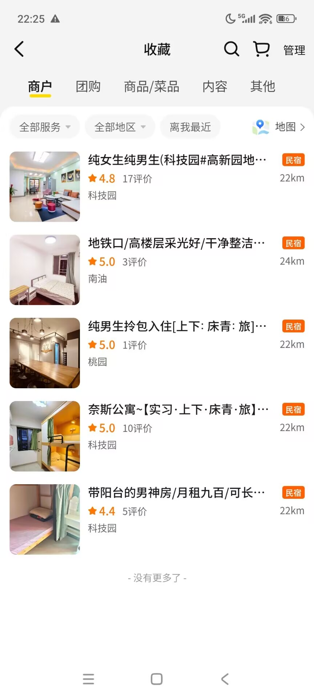
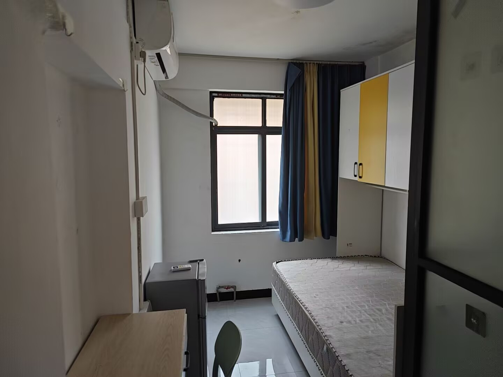
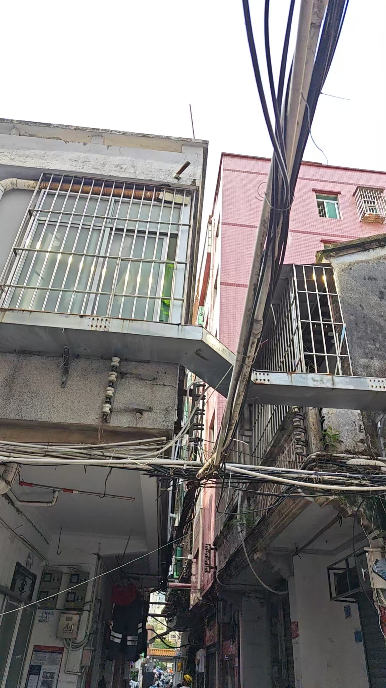
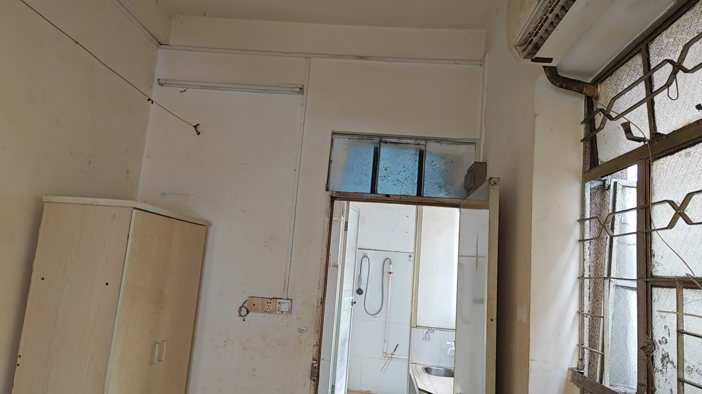
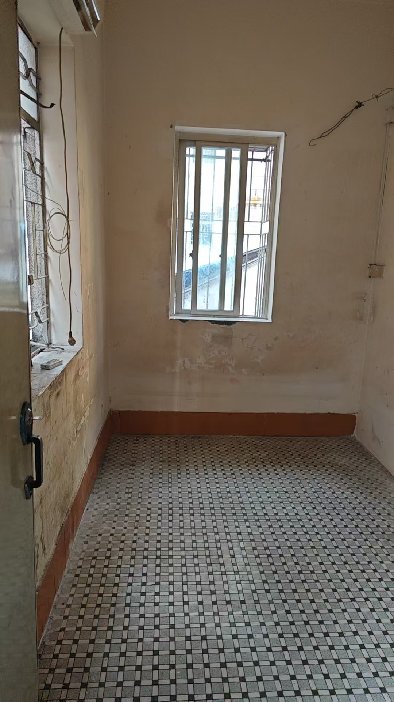

## 引子
正如前篇文章，也就是 [关于我在江苏这段实习](/posts/essays/internship/internship/) 的文章所说，我辞去了在江苏的工作，接受了字节的offer，于是也来到了新的城市--深圳，准备开启我的新的工作以及生活，而来到这里的第一个需求就是，租房

是的，租房。由于字节在深圳的公司地点位于深圳景湖大厦（**相当于深圳市中心了**），所以在要求通勤时间尽量少的情况下，房子是并不好租的，需要时间来考虑一下，而恰好的是，我在这边有亲戚，所以来的这两天就暂住在亲戚家，在B站上学习找房子攻略，同时借助各种软件去查询信息，然后锁定能够去找房子的区域，在要求短租的情况下，尽量找通勤时间少的房源，于是也就有了这篇文章，用来记录我的找房经历。

备注：**字节对于住得近的实习生有住房补贴，在有住房合同以及能够出示房东的房产证后，只要在步行30分钟内，或者自行车20分钟内，以及地铁20分钟内的范围内租房，就可以去申请房补，后面的租房参考都会将房补纳入考虑范围**

## 租房平台
这是最快捷，也是最方便的方式，因为你不用去跑，直接在手机上刷就可以了；这也是溢价最高的方式（个人看法），因为平台，中介都要在这里进行抽成。

怎么说呢，因为我是有了offer才来到的深圳，所以工作方面以及选址方面基本是确定的，而且有offer了嘛，也就表示有收入，就算平台有溢价，合理范围内也是可以接受的，方便也是其一大优点，甚至可以不需要实地去看房（但我觉得实地看房还是必要的），所以第一个去参考的途径就是租房平台，我个人用的是`自如`,对于28届，他有一定的补贴，押金可以减半，而且我亲戚认识的人也推荐这个，那还说啥了，看看先呗，反正刷刷又不要钱。

不过在租房平台需要注意，**有些房子只支持长租，不允许短租的，就算可以申请且申请通过，租金也有一定的涨幅**。

其实租房平台租房其实没有什么好讲的，而且大部分应该都支持`ai找房`了，根据条件划定范围，查看通勤，给出预算，其实就能筛选出适配的房源了。我在这里差不多选了3套吧，第二天一一去实地看房，然后根据自己的喜好以及周边的一些环境什么的，筛选出了一套最合适的，差不多就这样了，最后选择时也选的这套。

## 下面这些就是我在B站上学到的一些方法了：
### 1. 美团民宿
提到民宿，可能大部分人想的都是旅行时去住民宿，因为比酒店便宜啊，可能还更有人间烟火气一些，但是民宿本质上也是有空余房间的房东去出租自己的房间啊，只不过采用了一些酒店的运营方式而已，按照天来算钱，为什么不能考虑一下短租呢。

怀着这个想法，我去美团上一找，我去，b站的人这么厉害，竟然这都能给我找出来，b站上确实有很多的民宿和青年旅舍可以进行长租，这是一些我看着还可以的住宿

价格也是各有千秋吧，从月租900到2400不等，但是有一点要注意，就是如果提到是那种**上下床单人**，那么必定你是有室友的，也就是说，你租的本质上只是一个床位，而不是整个单间，和宿舍差不多，这时候你就要考虑和室友的生活规律是否符合的问题了，而一旦要租整个单间的话（下面是我在深圳的价格，也是个人目前的局限看法），那么租金也会水涨船高，提升到至少1500，水电这里我没问过，因为我个人觉得月租1500就和城中村租房以及平台找房价位差不多了，而且相较于城中村和平台，民宿这边同等价位可能平台和城中村的选择会更好一些，而且民宿也不稳定，房东随时会改变策略（**个人看法**），所以最终，我还是没有选择民宿长租。

### 2. 小区保安介绍
说来惭愧，其实我一开始没有考虑这条的，因为我个人的行程比较紧张，今天看房，明天就得确定入住并入住，而且我借住的地方和工作地点比较远，1小时的通勤，这也就意味着我不能住亲戚家以及慢慢看房，小区保安介绍这里是我平台实地看房时偶然遇到的，不过也可以用来讲讲。

说来偶然，小区保安介绍房源发生在我去平台实地看房这里，我迷路了，没找到具体进去的地方，去问了一下隔壁的一个保安，而刚好，这个保安是隔壁小区的，听说我是来租房并且在平台看房，马上就给我介绍起了他知道的房东以及符合需求的房源，大致看了几套房后，最后因为通勤有点远，吃不到房补，决定放弃，不过房子其实不错，价格也还行，下面这个月租1800。

### 3. 城中村
城中村基本是性价比之王了，很容易就能够找到单间出租的，但是需要花费精力去慢慢找，我个人的查找方式是，将地址，条件，以及距离要求合并在一起发给ai，让他帮我找出符合条件的城中村，然后我再一个个在导航软件上进行通勤距离的筛选，然后再自己到实地去进行考察以及找房东。

这里我通过导航软件筛选出了四个自行车21分钟（**好像没有更近的了，也许可以蹭房补**）的城中村（**指不定通过地铁站来反向筛选小区和城中村会更好？**），然后一一去实地考察了一下，有一说一，环境确实比较差。

结果是，基本每个村距离景湖大厦的自行车骑行距离似乎都没有小于等于20分钟的，就算混，也不一定蒙混过关，不过我还是去找了一下房源，算是去验证b站的说法吧。里面确实有很多房东直租的信息，很多，如果一个个去看的话，估计要耗费大量的时间，我就学着b站上的教程，走那种很窄很窄的小巷，结果刚好走到一户人家啊，估计是我一看就像外地的，人家直接就上来问了，就这样，又看了一套月租更低的房源，这一套月租1200啊，房东说可以提供床和桌子。

有一说一，这一套其实我是比较心动的啊，虽然有~~一~~亿点老旧，但是它有空调，独卫，~~虽然没热水和公共洗衣机~~，但它1200的价格确实很顶(**性价比人格发力了**)，不过大概去咨询了一下亲友和群友吧，最终还是决定放弃。

用群友的话说就是，这个房子这么破，里面还没东西，说明根本就没人住啊，我去不是接手了吗。
用亲友的话说就是，我是来深圳上班提升的，又不是有什么一定要赚够钱的目标，而且我又不是没找到工作。

很有道理，所以我放弃了。

后面也因为手机没电，所以房东直租的大部分电话我都没打，**真是失败啊**

## 结语
确实是一次失败的租房，因为兜兜转转，最终还是选择了平台租房，城中村没细看，小区没去问，就去手机查了一圈民宿，不过 [群友](https://blog.sheyiyuan.com/) 安慰我说，不是长期工作没那个精力不建议自己找，太花时间了。

确实是这个道理，我下半年才大三，基本只考虑短租的问题，而且来的时间也急，8.17就要开始工作，总不能顶着1小时的通勤先上着，就这样吧，尽管失败，尽管保底选择，但实际算下来其实也还行。

不管怎么说，我把这次失败的找房经历写下来，如果能给看到这篇文章的读者带来帮助，那就是对于我写的这篇文章最大的意义了。

