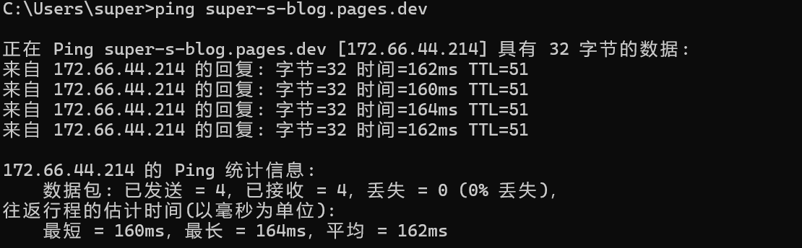

> 这不是一份“把某个参数调小就变快”的清单，而是一次从现象、证据、错误猜测到最终架构的完整排障记录。优化对象是部署在 Cloudflare Pages 上的 Astro 博客，首页同时包含 React、Three.js、GLSL 水面、HLS 背景视频、文章搜索和客户端路由缓存。

## 起因
这篇文章源自我的一次突发奇想，在公司访问了一下我的个人博客网站，由于之前根本没有访问过，所以自然没有任何缓存，所以...结果自然出乎意料的差，差不多整整过了17s（禁用缓存后重新看的），首屏才真正加载出来，开始播放动画，而且还存在各种其他问题，比如说，预览图明明已经加载出来，但是水面的纹理还是一片空白；在/`/index/`路由处刷新一下还会直接导致下面的栏目消失，实在是太严重了，~真不知道这是谁写的优化~，带着优化体感这一目标，于是就有了优化博客这次行动，也就有了这次文章。

## 一、初步测试与评估
既然是优化网站，那么肯定要先看一下目前的状况以及主要卡点在哪里，由于`lighthouse`测试会受到缓存的影响，所以本地初步测试与评估，采用了在网络中开启禁用缓存，用比较差的条件来测试网站正式的情况（不考虑2G以及3G网络），得到的结果自然也是比较差的：

- `DOMContentLoaded` 接近 20 秒。
- 首页水面需要十几秒甚至更久才出现。
- 预览图的请求也需要30s左右。
- MP4 首次请求耗时几十秒，完成后还会出现一次没有明确发起程序的请求。
- 搜索实现一度可能让全部文章正文进入首页客户端加载链路。

~onp，竟然能烂成这个样子~，确实很严重，已经严重影响到的博客的观感，事不宜迟，必须马上开始优化！

## 二、原因分析

### 1. 为什么看b站的视频很流畅，而我这里的视频要下载整整几十秒？

原因显而易见，就是 **cdn(内容分发网络)**，简单来说，它不是一台服务器，而是一个由遍布全球/全国的“节点服务器”组成的网络，核心作用就是用户可以从离他最近的节点处拿到对应的资源。

能流畅观看视频网站或游戏延迟正常，只能说明这些服务连接到各自 CDN 时表现正常，不能证明当前 Cloudflare Pages 节点也同样正常。

**而且注意：cloudflare的节点都在海外，所以虽然cloudflare部署时便捷迅速不用备案，但是加载速度嘛，自然也要慢上一些，而且就算采用国内的cdn，加速的也必须是国内有备案的域名，否则只能用海外节点，所以，国内备案的域名还不如用cloudflare的**

一次静态资源请求至少可以拆成：

```text
排队与连接 + 等待响应（TTFB） + 内容下载 + 浏览器解析、编译与执行
```

`ping` 测到的是 `ICMP` 往返时间。它不能覆盖 HTTP/3、TLS、Cloudflare 边缘缓存命中、浏览器连接调度、资源优先级和源站回源，因此只能作为旁证，不能代替浏览器 Performance 数据。



这张图片说明 `ICMP` 往返时间并不慢，所以问题还在于浏览器这一侧，需要禁用缓存后在浏览器侧进行线上测试

**ICMP主要用于在 IP 网络中传递控制消息，用于网络设备之间的故障报告和诊断，帮助设备检测网络连接问题**

### 2. Navigation Timing 给出的第一条证据

在禁用缓存后的页面控制台执行：
```js
const navigation = performance.getEntriesByType('navigation')[0];

console.table({
  responseStart: navigation.responseStart,
  responseEnd: navigation.responseEnd,
  domInteractive: navigation.domInteractive,
  domContentLoaded: navigation.domContentLoadedEventEnd,
  load: navigation.loadEventEnd,
});
```

得到：

| 阶段 | 时间 |
| --- | ---: |
| `responseStart` | 364 ms |
| `responseEnd` | 2758 ms |
| `domInteractive` | 2761 ms |
| `DOMContentLoaded` | 19976 ms |

HTML 在约 2.8 秒完成，DOM 也几乎立即可交互，但 DCL 又等待了约 17 秒。这说明问题不在“首页 HTML 包含太多文章导致 DOM 解析 20 秒”，而在 DCL 仍需等待的脚本链路。


### 3. Resource Timing 找到真正的等待者

进一步拆解脚本请求：

```js
performance.getEntriesByType('resource')
  .filter((entry) => entry.initiatorType === 'script')
  .map((entry) => ({
    name: new URL(entry.name).pathname,
    fetchStart: Math.round(entry.fetchStart),
    requestStart: Math.round(entry.requestStart),
    responseStart: Math.round(entry.responseStart),
    responseEnd: Math.round(entry.responseEnd),
    ttfb: Math.round(entry.responseStart - entry.requestStart),
    download: Math.round(entry.responseEnd - entry.responseStart),
    transferSize: entry.transferSize,
  }))
  .sort((a, b) => b.responseEnd - a.responseEnd);
```

当时几个关键资源的结果如下：

| 脚本 | 开始 | 耗时 | 结束时间 |
|---|---:|---:|---:|
| `SplashScreen` | 1986ms | 9434ms | 11420ms |
| `react` | 11430ms | 5900ms | 17330ms |
| `Layout` | 2761ms | 14355ms | 17116ms |
| `index` | 2761ms | 14492ms | 17253ms |
| `gsap` | 17117ms | 2853ms | 19970ms |

GSAP 的 `responseEnd` 约为 `19970 ms`，DCL 为 `19976 ms`，两者几乎重合。这里才形成了完整证据链：DCL 最后确实被模块脚本请求链拖住。

### 4. 响应头能说明什么

线上静态 JS 和 MP4 已经返回：

```text
Cache-Control: public, max-age=31536000, immutable
Content-Encoding: br        # JavaScript
Server: cloudflare
CF-Ray: ...-LAX
```

这说明长期缓存和 `Brotli(压缩算法)` 已经开启，但有两点需要注意：

1. DevTools 的“禁用缓存”会绕过正常浏览器缓存收益，它本来就是最差路径测试。
2. `immutable` 不能消除首次访问时的 Cloudflare 节点等待和内容下载。

因此缓存配置是必要条件，但不是首屏架构。真正稳健的首屏不能假定重型资源总能很快返回。

## 三、视频问题：为什么完整 MP4 会慢且可能请求两次

### 1. 观察到的现象

背景 MP4 大约为 6.59 MB。线上首次请求曾出现：

- 等待服务器响应约 13 秒。
- 内容下载约 25 秒。
- content-length: 6592072
- 响应码为200。
- 第一次请求结束后立即出现第二次 MP4 请求。
- 第二次请求在 DevTools 中没有明确的 JavaScript 发起程序。
- 视频开始播放后仍可能卡顿。

注意，由此可以直接暴露出第一个问题，**视频以及音频这种流媒体，正常的响应码应该是206（Partial Content），从而实现分片获取以及流式播放，而这里直接返回了整个文件，且响应码为200，说明cloudflare Page似乎并不支持206**

去查询了一下文档，果然如此，cloudflare Page团队正在努力开发，使得cloudflare Page支持206（。

[Serving Pages](https://developers.cloudflare.com/pages/configuration/serving-pages/)，所以该问题解决就不能依靠cloudflare了，得换一个方法。

同时，第二次请求没有脚本 initiator，不代表浏览器“凭空请求”。`<video>`、媒体解码器、范围探测、重新加载和 WebGL `VideoTexture` 的消费都可能由浏览器媒体栈内部触发，请求发起者不一定显示成某一行应用代码。

### 2. 单文件渐进式 MP4 的问题

一个完整 MP4 同时承担了以下职责：

- 首次播放数据源。
- 循环背景。
- Three.js 的视频纹理来源。
- 失败后的重新加载或范围读取对象。

如果部署路径没有稳定提供浏览器期望的 Range 行为，或者文件的关键元数据位置不适合快速起播，浏览器就可能等待更多字节。即使服务器支持 Range，单文件也很容易在弱链路上形成一个持续很久的大请求。

“文件只有几 MB，理论上十秒以内应下载完”只在吞吐稳定、TTFB 正常、没有丢包和调度竞争时成立。实际总耗时是：

```text
总耗时 = TTFB + 有效内容下载 + 重传/拥塞 + 浏览器调度等待
```

### 3. HLS 分片承担起播，原视频承担最终画质

既然要解决mp4的问题，那么首先就要解决请求时一次拉取整个文件的问题，这里我决定采用`HLS`来将视频进行分片处理，每次请求只进行单个分片的请求，这样虽然增大了请求的数量，但是每个请求所请求的文件更小，响应自然更快。且 `HLS` 不依赖 Pages 的 Range 支持，因为每个 2 到 4 秒的分片本身就是一个完整小文件。

#### 什么是HLS
`HLS (HTTP Live Streaming)` 是由 `Apple` 公司提出的基于 `HTTP` 的流媒体网络传输协议。 它的工作原理是把整个流分成一个个小的基于 `HTTP` 的文件来下载，每次只下载一些。 当媒体流正在播放时，客户端可以选择从许多不同的备用源中以不同的速率下载同样的资源，允许流媒体会话适应不同的数据速率。 而 `M3U8` 就是 `HLS` 协议中的“索引文件”。

#### 最终方案

采用两级方案：

```text
预览图
  -> HLS 低清分片快速起播
  -> 后台低优先级下载原始 MP4
  -> 原视频完成下载并可解码后切换
  -> 销毁 HLS 实例
```

当前资源分为：
| 设备 | HLS 首播版本 | 原视频 |
| --- | --- | --- |
| 桌面端 | 480p，7 个 `.m4s` 分片 | `WUWA-desktop.mp4`，约 6.59 MB |
| 移动端 | 360p，7 个 `.m4s` 分片 | `WUWA-mobile.mp4`，约 3.30 MB |

低清 HLS 的目标是尽快、连续地开始播放；原视频则是用于最终升级，保证视频质量。

### 4. hls分片方案的配置

采用分片还有一个局限，就是当前分片播放完成而下一片未到时，视频会停在某一帧，人物眨眼等画面尤其明显。

因此现在不是只判断 `canplay`，而是计算当前播放位置前方的缓冲时间：

```text
START_BUFFER_SECONDS = 6
```

只有缓冲达到目标值才调用 `play()`。这是用略晚的起播换取连续播放，避免首片结束后马上饿死。

HLS 的关键限制包括：

- `backBufferLength: 30`
- `maxBufferLength: 30`
- `maxMaxBufferLength: 60`
- `maxBufferSize: 12 MB`

这些限制防止背景视频无限积累分片占用内存。

### 5. 原视频升级方案

后台升级不会直接把正在播放的 `<video>` 改成远程 MP4，而是：

1. 使用低优先级 `fetch()` 下载完整原视频。
2. 转成 Blob URL。
3. 用临时 `<video>` 验证元数据和首帧能否解码。
4. 记录当前 HLS 播放时间。
5. 销毁 HLS，切换到 Blob URL。
6. seek 到对应时间并继续播放。

这样可以避免“源地址已切换，但原视频还没准备好”导致的长时间黑屏。

### 6. Worker 代理的作用和边界

在上面的 `HLS` 方案里，真正保证起播的是小分片和缓冲策略；而原 MP4 则作为后台补全源。与此同时，站点还保留了一层边缘代理：`/media/background/*` 会经过 `Cloudflare Pages Function`。

这里的 `Worker` 代理，本质上就是部署在 Cloudflare 边缘节点的一个 `JavaScript` 运行环境，它可以拦截、判断和改写 HTTP 请求与响应，像一个轻量级的边缘网关。它不等于传统后端服务，也不等于流媒体服务器，而更接近“请求入口 + 缓存策略 + 协议适配器”。如果把 `Nginx/Apache` 看作站点入口层，那么` Worker` 就是离用户更近的一层边缘处理层。

对这条媒体路径来说，它做的事情大致是：

- 使用 `Cache API` 缓存静态媒体响应。
- 设置一年 `immutable` 缓存。
- 识别客户端 `Range` 请求，并在边缘返回 `206 Partial Content`，`Content-Range` 和 `Accept-Ranges`。
- 限制可访问根目录，拒绝非法路径。

这意味着它确实可以在边缘完成路由判断、缓存命中、范围请求兼容和响应头重写；如果浏览器向 `/media/background/*` 发起 `Range` 请求`，Worker` 可以先接住，再决定是直接从缓存返回，还是回源后裁剪对应字节区间再返回。这样一来，浏览器能更稳定地接收 `206` 响应，调用链也更容易兼容。

但需要诚实说明：这里的` Worker` 更像是“边缘代理 + 协议适配层”，而不是原生流媒体服务器。它在处理 `Range` 时，通常需要先拿到缓存中的源响应，再在内存里截取对应字节区间，因此它改善的是协议兼容性和边缘缓存复用，而不是首次未缓存时真正从源站按字节流式读取。也就是说，Worker 能让浏览器接受 `206`，提升兼容性，但真正能保证低延迟起播的，仍然是 HLS 小分片方案。

这也是这次方案里最关键的边界：Worker 负责“让请求更顺”，HLS 负责“让视频更快播放”。两者不是替代关系，而是互补关系。

### 7. 预览图请求优先级提高，进入页面时不至于看到空水面

`WUWA-poster.jpg` 来自视频第一帧，约 169 KB，并通过以下方式提高优先级：

```html
<link rel="preload" as="image" href="/background/WUWA-poster.jpg" fetchpriority="high">
```

页面 `` 同样使用 `fetchpriority="high"`。Three.js 完整场景创建后，先从已经存在的图片元素创建纹理；只有视频具有可用解码帧时才把混合目标切向 `VideoTexture`。

## 四、音频问题：刷新可播，客户端路由进入却不请求

### 1. 现象指向生命周期，而不是文件损坏

文章音频问题表现为：

- 直接刷新文章页可以播放。
- 强制刷新也可以播放。
- 从其他页面通过 Astro 客户端路由进入时不请求、无法播放。
- 浏览器前进后退同样可能失效。

如果编码或 CDN 完全不可用，刷新后也不会恢复。这个差异直接说明问题位于客户端路由交换后的媒体生命周期。

### 2. Astro 页面交换不会重演完整浏览器导航

客户端导航会替换 DOM，但不会完全重复一次传统页面加载。新的 `<audio>` 元素可能已经进入 DOM，却处于：

- `NETWORK_EMPTY`
- `NETWORK_NO_SOURCE`
- `HAVE_NOTHING`
- `currentSrc` 为空
- 前一次错误状态未清理

只依赖 HTML 中的 `preload="auto"` 并不足以保证页面交换后重新发起请求。

### 3. 当前音频生命周期管理

`articleAudio.ts` 为每个音频建立状态，并在以下时机激活：

- 初始页面启动。
- `astro:page-load`。
- LRU 缓存页面重新激活。

激活时会在下一帧检查 `currentSrc`、`networkState`、`readyState` 和 `error`。只有状态无效时才调用 `audio.load()`，避免无条件重复下载。

页面失活时：

- 暂停音频。
- 标记为 `inactive`。
- 从正在播放集合移除。

发生一次加载错误时允许延迟 500 ms 重试一次，避免无限重试。

### 4. 音频和背景视频需要协调

文章音频开始播放后，页面会发布：

```text
foreground-audio-state: active
```

背景视频原画质升级如果正在下载会被取消，尚未开始则延后。这样可以避免 1.46 MB 的 M4A 与几 MB 的背景原视频同时争抢带宽，导致音频时断时续的问题。

## 五、搜索：不是把全部文章塞进首页

### 1. 曾经的风险

搜索需要文章标题、摘要、标签和正文。如果直接在 Astro 页面中把全部文章作为 React/客户端组件 props，构建器可能把整份文章数据序列化进首页 HTML 或客户端脚本。

这会造成：

- `index.html` 随文章数量持续增大。
- 用户不使用搜索也必须下载搜索正文。
- JSON 解析和搜索索引创建进入首屏主线程。
- DCL 和首屏时间随着文章数量增长。

但排查中也纠正了一个误判：当时 20 秒 DCL 并不是因为浏览器解析了全部文章。Navigation Timing 已证明 HTML 较早完成，真正的长尾来自脚本请求链。

### 2. 搜索数据独立成静态端点

现在由 `/search-index.json` 在构建时输出搜索数据：

```ts
{
  id,
  title,
  description,
  category,
  tags,
  body,
}
```

首页 `HomeView` 仍然只渲染按日期倒序的最新 3 篇文章：

```text
posts.sort(...).slice(0, 3)
```

因此“搜索覆盖全部文章”和“首页只显示三篇文章”是两条独立数据链。

### 3. MiniSearch 也必须懒加载

只把 JSON 拆出去还不够。如果顶部导航静态导入 MiniSearch，库本身仍会进入初始脚本依赖图。

当前实现使用动态导入：

```ts
const loadMiniSearch = () => {
  miniSearchModulePromise ??= import('minisearch');
  return miniSearchModulePromise;
};
```

用户聚焦搜索框或开始输入后，才会同时加载 MiniSearch 和 `/search-index.json`。Promise 会被复用，避免同一页面重复创建索引。

这项改动的原则是：

> 不使用搜索的访客，不应该为全文搜索支付首屏成本。

## 六、DCL 优化：从约 20 秒降到约 5.6 秒

### 1. DCL 等待什么

`DOMContentLoaded` 不会等待普通图片和视频完整下载，但会受到模块脚本、延迟脚本及其依赖图影响。

因此优化 DCL 的目标不是盲目压缩所有资源，而是缩短初始模块依赖链。

### 2. 移除 GSAP
由前文可知
| 脚本 | 开始 | 耗时 | 结束时间 |
| `gsap` | 17117ms | 2853ms | 19970ms |
`GSAP` 的 `responseEnd` 约为 `19970 ms`，DCL 为 `19976 ms`，两者几乎重合，重复测试计次两者时间都差不多，所以可以判定 `GSAP` 拖慢了 DCL 的时间，且 `GSAP` 在本项目中用的不多，完全可以使用原生 animations，所以直接移除了 `GSAP`

首页入场和 TopBar 动画改用浏览器原生 Web Animations API：

```ts
element.animate(keyframes, {
  duration,
  easing,
  fill: 'both',
});
```

滚动回顶部使用原生 `window.scrollTo({ behavior: 'smooth' })`。在项目已经不需要 GSAP 特有时间线能力后，继续保留它只会增加一个网络请求和模块依赖。

GSAP 移除后，旧测试中与 DCL 几乎重合的最后一项脚本请求消失，DCL 下降到约 5.6 秒。

### 3. 拆分 React 水面岛

`SplashScreen` 不再静态导入完整水面和鼠标水面，而是：

- 先做 WebGL 兼容性检测。
- 支持主水面时动态导入 `WaterScene`。
- 主水面触发 `water:ready` 后再导入 `PointerWaterLayer`。
- 普通 `/index/` 使用 `client:idle`，完整开场 `/` 使用 `client:load`。

这样 PointerWater 不会和主水面抢首屏下载与 GPU 初始化时间。

### 4. 样式不再产生一次额外的冷缓存等待

线上冷缓存时，外部 CSS 同样可能遭遇高 TTFB。为了让页面拿到 HTML 后即可建立 CSSOM，当前全局 CSS 通过 `?inline` 写入 HTML。

它的优点是：

- 消除独立 CSS 请求的等待。
- 避免 CSS 未完成时浏览器延迟首次绘制。

代价是：

- 每个 HTML 都包含完整全局 CSS。
- 当前首页 HTML 大约为 100 KB 级别。
- CSS 无法作为独立文件跨页面复用浏览器缓存。

这是针对当前 Cloudflare 冷请求长尾做出的取舍。若以后文章和样式显著增大，应改为“极小关键 CSS 内联 + 完整 CSS 异步加载”，而不是无限扩大内联内容。

## 七、首屏优化：DCL 变快不等于水面变快

### 1. 为什么 DCL 已经变快，水面仍要十几秒

移除 GSAP 后，DCL 明显下降，但完整水面仍依赖：

```text
Astro island hydration
  -> React runtime
  -> SplashScreen
  -> WaterScene
  -> Three.js（约 500 KB 级别 chunk）
  -> Shader 编译与第一帧
```

只要其中某个静态模块出现高 TTFB，用户就仍然只能看到空背景。这说明“把 DCL 优化到 5 秒”不能自动得到“5 秒看到水面”。

### 2. 两阶段水面

最终增加了不依赖 React、Three.js 和 HLS 的 `WaterBoot.astro`：

- Canvas 和脚本直接写进 HTML。
- 使用原生 WebGL2 绘制全屏三角形。
- 使用预览图作为纹理。
- 只保留轻量时间扰动和鼠标位置 uniform。
- 完整 WaterScene 到达后淡出并销毁启动 Canvas。

这让首屏从“等待完整 Three 场景”变成“HTML 到达即可启动一个较轻的水面”。

### 3. 视频必须晚于首屏启动

背景视频初始化延后约 1.8 秒，避免 HLS.js、播放列表和视频分片与 WaterScene、Three.js、预览图争抢首屏连接。

这不是让视频总是更慢，而是明确优先级：

```text
页面结构和预览图 > 基础水面 > 完整水面 > 背景视频 > 原视频升级
```

### 4. 一次严重回归：轻量水面跳过了开场动画

最初为了让首屏立即可用，WaterBoot 在第一帧主动发送了：

- `water:first-frame`
- `water:intro-skip`
- `water:reveal`

这对 `/index/` 合理，但根路径 `/` 本来需要完整的水滴、冲击和内容揭幕动画。结果是页面直接跳到 `/index/`，开场动画完全消失。

修复方式不是增加更多延迟，而是区分两个页面的语义：

| 路径 | WaterBoot 职责 | 谁控制 reveal |
| --- | --- | --- |
| `/` | 仅作动画层下方的占位 | 完整 `WaterScene` 和 `homeReveal` |
| `/index/` | 立即提供可见水面 | WaterBoot 先显示，完整场景随后增强 |

根路径的启动 Canvas 使用更低的 z-index，不发送任何跳过 intro 的事件，也不设置会被 `homeReveal` 误识别的首帧标记。

这次回归留下的教训是：性能优化不能只按资源类型拆分，还要保留页面状态机的业务语义。

## 八、客户端路由、Keep Alive 与请求节流

### 1. 为什么不能把整个 Astro swap 全部替换掉

页面切换时水面先消失再挂载，是因为默认 swap 会替换包含 Canvas 的 DOM。完全重写 swap 会连带破坏 Astro 对 head、脚本、根属性、焦点和过渡状态的处理。

最终方案只持久化 WebGL 外壳，并继续复用 Astro 提供的 swap 函数处理其余部分：

- `deselectScripts`
- `swapRootAttributes`
- `swapHeadElements`
- `saveFocus`

页面内容壳单独替换，Canvas 不参与销毁和重建。

### 2. LRU 只保留最近 5 个页面

Keep Alive 缓存保存：

- 页面内容 shell。
- head 快照。
- html/body 属性。

缓存键包含路径和查询字符串，最多保留最近 5 个页面。命中时页面从失活状态恢复，未命中才正常请求。被淘汰的页面交给垃圾回收，避免长期访问后内存只增不减。

### 3. 点击节流必须等导航完成后释放

最早的“固定时间节流”无法覆盖 Cloudflare 1 到 2 秒甚至更长的导航时间。时间到了但页面还没成功加载，用户再次点击仍会触发重复导航。

当前实现使用一个导航 Promise：

```text
第一次点击
  -> 创建 activeNavigation Promise
  -> 设置 data-navigation-busy
  -> 调用 Astro navigate()
  -> 忽略后续点击
  -> after swap / page load 完成
  -> resolve Promise
  -> 解除 busy
```

另有 30 秒 watchdog。如果 Astro 导航始终没有完成，才退化为 `window.location.assign()`，避免永久锁死。

曾经出现“第一次点击没请求，第二次点击产生两次请求”，原因就是捕获阶段自定义点击监听、Astro 导航和 LRU loader 的责任边界没有统一。修复重点不是再加一个 debounce，而是保证只有一个导航所有者，并以真正的页面完成事件释放锁。

## 九、缓存策略

静态且文件名稳定的资源使用一年缓存：

```text
/background/*
/image/*
/audio/*
/media/*
/live2d/*
/_astro/*

Cache-Control: public, max-age=31536000, immutable
```

HTML 使用边缘短缓存和 stale-while-revalidate：

```text
Cache-Control: public, max-age=0, s-maxage=600, stale-while-revalidate=86400
```

搜索索引使用：

```text
Cache-Control: public, max-age=3600, s-maxage=86400
```

这里有一个维护约束：`immutable` 只适合内容改变时 URL 也改变的文件。`/_astro/*` 自带哈希，天然安全；但 `WUWA-poster.jpg`、音频和固定名称视频如果原地替换，用户可能继续使用一年旧缓存。更新这些资源时最好改文件名或增加版本路径。

## 十、没有采用或不能单独解决问题的方案

### 1. 只使用 Cloudflare Worker

Worker 能统一响应头、Range 和 Cache API，但不能保证用户到 Cloudflare 节点的链路变快，也不能消除首次回源。对大媒体而言，协议兼容不等于稳定流式播放。

### 2. 只依赖 Cloudflare 免费 CDN

Cloudflare Pages 本身已经经过 Cloudflare 边缘网络。增加缓存规则有帮助，但无法修复前端关键路径过长、视频单文件职责过多、搜索数据进入首屏等架构问题。

### 3. 为轻量水面再引入一个渲染库

曾考虑 `ogl`，但首屏问题的核心就是依赖链过重。原生 WebGL2 启动层只有少量 shader 和状态设置，不需要再增加一个网络模块。PixiJS 更不适合作为首屏补救，因为体积和初始化成本都更高。

### 5. 只看 DCL

DCL 可以下降，但完整水面仍可能很晚。应同时观察：

- FCP/LCP。
- `water-boot-first-frame`。
- `water-poster-texture-ready`。
- `WaterScene` 的 `renderer-ready`、`first-frame` 和 `water:ready`。
- HLS 首片、缓冲长度和 `playing`。

## 十一、以后再次变慢时如何排查

建议保持以下顺序：

1. 使用无痕窗口测试一次正常缓存，再测试一次禁用缓存，不要只看最差路径。
2. 记录 Navigation Timing，先判断 HTML、DOM 解析还是 DCL 依赖链。
3. 导出脚本 Resource Timing，拆开 TTFB 和 download。
4. 检查 WaterBoot 是否在完整 WaterScene 前出现。
5. 检查预览图是否早于 HLS 和原视频完成。
6. 查看 HLS 分片是否连续、缓冲是否达到 6 秒。
7. 从站内路由进入含音频文章，检查 `currentSrc`、`networkState` 和 `readyState`。
8. 聚焦搜索框前确认没有 MiniSearch 和 `/search-index.json` 请求。
9. 检查根路径开场是否仍由完整 WaterScene 控制，避免性能代码误发 reveal 事件。
10. 最后再考虑 CDN、Worker 或更换部署区域，不要用基础设施解释所有前端问题。

可以用下面的脚本同时查看关键性能标记：

```js
const navigation = performance.getEntriesByType('navigation')[0];
const marks = performance.getEntriesByType('mark')
  .filter((entry) => /water|poster|video/i.test(entry.name))
  .map((entry) => ({ name: entry.name, startTime: Math.round(entry.startTime) }));

console.table({
  responseEnd: Math.round(navigation.responseEnd),
  domInteractive: Math.round(navigation.domInteractive),
  domContentLoaded: Math.round(navigation.domContentLoadedEventEnd),
});
console.table(marks);
```

## 十二、这次优化得到的结论

1. **先区分 TTFB、下载和执行，不要把所有慢都叫作网络慢。**
2. **刷新可用、客户端导航不可用，优先检查组件和媒体生命周期。**
3. **DCL 只是一个阶段，不代表用户已经看到首屏核心内容。**
4. **首屏必须有一个不依赖重型运行时的最小可用表示。**
5. **媒体需要分层：预览图负责立即可见，HLS 负责连续起播，原文件负责最终质量。**
6. **搜索属于按需功能，全文数据和搜索库都不应进入默认首屏。**
7. **缓存能优化第二次访问，架构才能保护第一次访问。**
8. **性能优化不能破坏页面状态机。根路径开场动画和普通首页不是同一种首屏。**

在节点波动无法完全控制的情况下，前端真正能做的是缩短关键路径、限制并发竞争，并保证每个阶段都有可用的视觉结果。最终的目标不是让所有资源同时更快，而是让用户不必等待所有资源都完成，页面就已经可以被看见和使用。

## 十三、总结
经过这一轮优化，最终，线上冷加载可以在大约 6 秒（最坏情况下有 10 秒）看到完整水面。受 Cloudflare 节点、线路和禁用缓存测试方式影响，这并不是一个绝对值，但首屏已经不再被视频、搜索和非必要动画库共同阻塞。

当前加载流程可以概括为：

```text
HTML + 内联关键样式
        |
        +--> 高优先级请求预览图
        |
        +--> 内联 WaterBoot 绘制轻量水面
        |
        +--> 页面内容直接可见（/index/）
        |
        +--> 异步加载 React + WaterScene + Three.js
        |         |
        |         +--> 完整水面首帧
        |         +--> 再加载 PointerWaterLayer
        |
        +--> 延后启动 HLS 背景视频
                  |
                  +--> 低清分片先播放
                  +--> 缓冲足够后开始播放
                  +--> 后台低优先级下载原视频并平滑升级
```

根路径 `/` 是例外：它保留完整开场动画，只有动画完成后才把地址替换为 `/index/`。轻量水面在这里仅作底层占位，不能发送跳过开场的事件。

总体感觉还是不错的。
