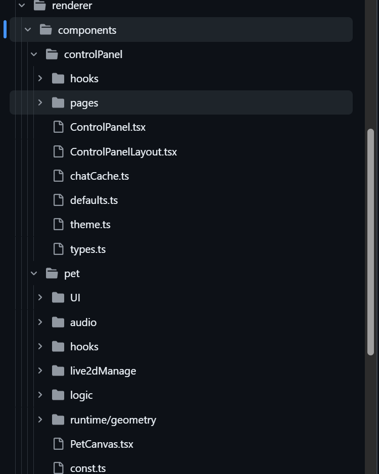
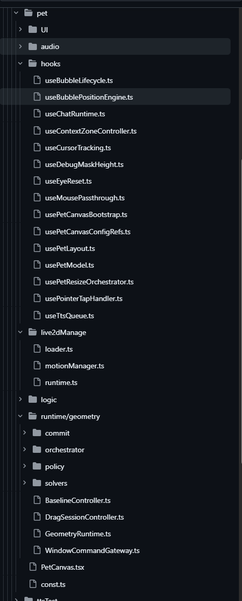

> 本文不完整介绍 DDD，只是分享DDD的思想以及个人实战经验

传统水平分层通常按技术职责来组织代码。在 React 项目里，常见的目录就是 `components`、`hooks`、`types` 和 `utils`：组件归组件，状态和副作用逻辑归 hooks，类型定义和通用函数也各自归档。这种分法能清楚体现每块代码在技术上的角色，项目规模小的时候，找代码和复用代码都比较快。

但一个完整的业务功能，往往会同时牵扯好几个技术层。比如“编辑用户资料”这个功能，可能包括负责表单展示的组件、负责加载和提交数据的 Hook、描述表单和接口结构的类型，以及校验或格式化的工具函数。按技术角色一分层，这些本来相关的代码就被拆到了好几个目录里。业务和团队一变大，同一个目录里还会堆进许多互不相关的功能。

结果就是，改一个业务功能时，开发者得先判断逻辑分别落在哪些技术层，再跨目录去找、去追。代码审查也一样，得在多个位置之间来回切换，才能确认一次改动有没有覆盖这个功能的完整流程。水平分层并不是不能用；项目小、业务关系简单的时候，它依然直接有效。但项目扩大、功能变多以后，只按技术角色组织代码，业务代码会越来越不好找，跨文件理解和修改的成本也会上升。

一种改进思路是：先按业务领域或具体功能划分代码，再在每个业务目录内部按技术职责组织，比如各自下设 `components`、`hooks`、`types` 和 `utils`。这样既保留了按技术角色归档的清晰度，也让同一个业务功能的相关实现更集中，查找和维护都更方便。接下来要讨论的垂直领域分层，就是从这种组织思路出发的。

## 垂直领域分层
**垂直领域分层，也就是根据业务划分文件架构，组织代码。**

根据业务职责划分模块，再把一个模块完成该业务所需的界面、状态、规则和外部交互等代码放在同一边界内。它的首先关注的是“这段代码服务于哪项业务能力”，而不是“这段代码属于哪种技术角色”。

业务能力内部，你就可以直接再根据功能进行文件架构的划分，这样，所有代码都基于业务被组织，而不是散布在全局同类功能目录中，在修改时就可以只在这一个模块内修改，避免在各个文件夹之间跳来跳去的处境。

一个业务模块也不必机械地包含所有层级或目录。简单功能可以只由少量文件组成；只有当职责、复杂度或复用需求真实出现时，才进一步拆分。被多个业务模块共同使用的能力可以放在共享层。

简单来说，其实就是根据业务来划分模块，再在里面进行功能的划分，做到内聚性提升的同时，代码的解耦度也高。


这个方法当然很好，我之前也是经常这么做的，但，如果一个业务中包含了各种数据的查询，和其他模块的数据沟通，或者说是复杂的处理逻辑呢？



如图所示，之前我的 [桌宠项目](https://github.com/ganyudedog/live2dMurasame/tree/a089134fb4cadb886973774e8f58d421ff400fa4) 就是这么分的，看着确实没问题吧，但是，如果你再展开里面呢？



可以看到文件的数量就比较多了，而且，最核心的，主要ui呈现组件`PetCanvas`高达1263行，这还是我拆出一堆hooks的结果，为什么会这样呢？主要原因有：

1. 这里负责了live2d的展示，布局的编排，模型的眼睛跟随鼠标，后端以及sharedworker的同步等等各种逻辑
2. 尽管拆出了大部分的hooks，但是hooks返回产物的编排，数据之间的交互逻辑，冲突之下的优先级，全部都依赖`PetCanvas`，而且还导致了两个巨大的问题，**同级hooks之间相互依赖**和**ui和逻辑耦合**，导致数据流并不单向，排查问题极其困难，而且很容易出现数据双写的问题。

当然不只是我会遇到这种情况。只要一个页面需要协调多个子系统，而这些子系统又各自拥有异步任务和生命周期，主组件就很容易从“页面组合器”逐渐变成“业务总调度器”。

例如，一个在线音视频会议页面可能同时挂载本地音视频设备、远端视频流、参会者列表、聊天区和屏幕共享组件。它们各自需要申请或释放资源、注册事件监听、处理连接状态；而页面还要负责协调加入会议、设备切换、断线重连、静音状态同步和离开会议时的统一清理。若这些流程都由页面组件直接编排，局部生命周期之间的依赖就会不断堆积。

再比如，一个可视化编辑器通常包含画布、图层面板、属性面板、工具栏和历史记录。画布可能维护指针事件和渲染循环，图层面板订阅选中对象，属性面板根据当前对象动态创建表单，历史记录则要监听编辑操作并支持撤销重做。页面不仅要挂载这些组件，还要确保它们使用同一份文档状态，并处理文档切换、异步加载、保存和卸载。任何一个环节的时序或状态不同步，都可能造成界面显示与实际文档不一致。

复杂表单向导也有类似问题：步骤组件可能按需挂载，每一步单独校验和保存草稿；主页面需要管理前进、后退、跳步、整体提交和离开确认。随着步骤和规则增多，流程判断容易散落在页面回调和各步骤组件之间。

这些场景的共同点不是“组件数量多”本身，而是多个拥有独立状态和生命周期的部分，必须围绕同一个业务流程协作。此时主组件承担的就不再只是 UI 组合，而是在决定业务状态如何流转、操作顺序如何安排、冲突如何解决以及资源何时释放。把这些职责都压在主组件里，会让组件结构、业务流程和副作用相互缠绕。

这也引出了我接下来想讨论的问题：当代码需要表达的不只是界面结构，而是业务概念、规则和协作边界时，是否有一种方法能帮助我们更好地理解和组织它们？这也是我接下来要说的，DDD。

## DDD
先来介绍一下概念吧。DDD 又名领域驱动设计（Domain-Driven Design），是一种以业务领域为核心的软件设计方法。它并不是固定的目录结构或技术模板，而是通过分析业务概念、业务规则及其边界，建立能够准确表达业务的模型。

看起来感觉很复杂，其实从数据流的角度来看，其实就是
```
前端->服务->模型->接口
```

其中，前端表示用户交互和请求入口，service则是用于将前端的操作转换成`模型语言`，模型接收到`模型语言`后，调用相关的领域事务，然后将涉及到数据库修改的部分，拼装成接口需要的部分，然后传到数据库，注意，其中**服务这里只能协调领域服务或聚合完成用例，不涉及到任何业务规则的处理**

举个例子，比如说我点击了一下live2d模型，这里触发前端操作，然后打到`live2dService`中，`live2dService`根据你的操作，判定是触发动作交互，然后调用动作模型的`playMotion`，然后模型展示对应的动作，如果触发接口操作，再在这里调用对应的接口。

看起来确实复杂了许多，因为传统前端中，操作应该是触发前端操作，调用对应的`onClick`，触发状态变化，hooks执行副作用，如果涉及到后端变化，则是在状态变化时进行接口上传。

没错，如果只有这一个功能，DDD这里是明显增加了复杂度的，但是，一般的效果往往不会这么简单。

同样的例子，如果我需要在`playMotion`的时候同步展示对应的语音气泡，语音停那么气泡3s后消失呢？如果我需要对语音气泡的展示进行优化呢，比如说一段文字没达到100px就一行展示，宽度到达100px，接下来的文本就换行呢？如果我希望一次最多展示四行，多了就翻页展示呢？

解法其实很多，我在组件里面挂载一个气泡组件，平常返回null，当触发playMotion的时候，传入文本挂载，然后监听播放器实例的 `ended` 事件；但是这是不是意味着额外生命周期的挂载，因为你要看气泡什么时候卸载，还要执行卸载后的副作用，当然，如果只有这一个，其实传统前端还是便利得多。

但是往往需求不会这么简单，产品可不会轻易放过你，接下来的第二个问题也很好解决，我额外挂载一个`react root`，把文本放在里面测量，测量拿到数据后，卸载额外的`react root`，然后根据测量结果来进行排版。但这里，又是一个额外的生命周期，还和气泡关联上了。

那第三个问题呢，多了翻页展示这里，其实也有解法，我一句一句的塞到测量根中，如果下一句进去后超过了四行，那么下一句就作为下一页的开头，但这样，测量根需要气泡这里一句句的添加，气泡又需要测量根的测量结果，这就形成一个双向依赖了，那么中间就很容易出问题。

那么这里就需要一个东西来进行管理，将其变为单项链路，也就是
```
文本->测量根->测量结果输出->主组件排版文字
```

hooks当然可以在这里进行管理，但这也就意味着，hooks并不再是局部生命周期管理和副作用执行了，它承担了业务规则，能力排版，以及状态管理，组织了一个复杂的业务流程，所以这也是函数式编程的问题：

**副作用不可控，代码耦合严重：业务逻辑中混杂全局变量修改、日志打印等副作用，一个函数的执行结果会影响其他函数，代码牵一发而动全身，复用性极低。**

那如果复用上面DDD的链路呢，我可以直接在模型在内部还可以创建多个`能力聚合对象`，来解耦对应的能力，同时在模型中编排对应的能力聚合对象，实现业务规则，也能够解耦双向依赖，形成单向数据流，打点调试都很方便，在对应的能力中添加日志即可。

所以，为什么我们要使用DDD，因为DDD强调明确职责、划分边界、减少相互耦合，同时能够管理组件生命周期和副作用，在减少主组件冗余的同时，也能够有效进行调试。

## 实用DDD
但是DDD还有一个问题，就是DDD是要求建模的，根据数据链路
```
前端->服务->模型->接口
```

可以得到，服务是专门额外的一层，只能协调领域服务或聚合完成用例，不涉及到任何业务规则的处理，所有业务规则必须到模型中去处理，也就是，模型承担所有，而服务只负责转发。

但这样就会有一个问题，就是大部分业务流程其实并不复杂，比如说数据上传后端，我为什么要单独再走一遍流程呢，而且还给模型添加了不必要的接口，制造了不必要的生命周期管理；而且大量逻辑本质是流程编排（查数据、校验、调外部、写库），这些天然属于服务，为什么要落到模型里面去呢，这也就是我们接下来讲的，实用DDD，也就是我当前项目用的方法论。

所谓实用 DDD，就是**按逻辑的归属来分配，而不是按教条来分配**，这是在 DDD 的思想基础上，根据业务复杂度和变化频率选择合适的建模程度。它不要求每个功能都具备`能力内聚模型`，而是优先保证业务边界清晰、规则归属明确，并避免为简单流程引入过多抽象。

简单来说，就是流程主要由 Service 负责，模型负责可复用的业务类型、纯函数、解析、归一化和局部规则；只有复杂度真正出现时，才进一步引入实体、聚合等更重的模型。

同样是我上面举的`playMotion`，其实就是一个流程编排的问题，它没有很复杂的逻辑，只是在前端hooks的结构以及需求增多的情况下，形成了一个双向的数据流而已。

## 个人实战
看下来，其实可以发现，DDD和垂直领域设计，其实是有共通之处的，就是他们“都是基于专门的业务去分层”，而不是根据功能来进行拆分，且这两者并不冲突，因为垂直领域设计主要解决上层拆分，而DDD则是用于解决流程编排，副作用管理以及复杂业务规则，将两者结合起来，也就是按照业务能力划分出相对独立的模块，再在模块内部根据实际需要组织 服务、模型、基础设施和 UI。垂直领域设计负责回答“这段代码属于哪个业务能力”，DDD 则帮助我们回答“这个业务能力中的概念、规则和流程应该由谁负责”。前者解决代码的空间组织，后者解决业务逻辑的职责归属，两者关注的层次不同，但可以互相配合。

在这种结构下，服务 作为业务能力的主要入口，负责协调数据查询、状态变化、外部调用和多个步骤之间的流程；模型 则集中放置业务类型、纯函数、解析、归一化以及相对稳定的局部规则；基础设施负责承接网络、文件、IPC 和第三方 SDK 等副作用；UI 只负责展示状态和收集用户操作。只有当某个业务规则足够复杂，或者需要在多个流程之间保持一致时，才有必要继续引入更明确的实体、聚合或领域服务。

再结合一下DI(依赖注入)和工厂装配，就可以得到我目前的架构，也就是

以业务能力为边界，由一个主 Service 作为模块的统一入口，再由主 Service 持有和协调多个职责明确的子 Service。以 Live2D 模块为例，`Live2dService` 负责对外提供模型运行时的主要能力，同时将动作、布局、交互、气泡和浮动输入等相对独立的职责，分别交给 `Live2dActionService`、`Live2dLayoutService`、`InteractionService`、`BubbleDialogueService` 和 `FloatingComposerService` 等子 Service。

这里的子 Service 并不是为了机械地拆分类文件，而是因为它们拥有相对独立的状态、生命周期或业务流程。例如，布局服务负责窗口几何和模型布局事务(`Live2dLayoutService`)，动作服务负责动作能力与执行状态(`Live2dActionService`)，气泡服务负责文本展示和测量流程(`BubbleDialogueService`)。主 Service 只保留跨能力的协调逻辑，并把自身的状态作为这些子服务之间的连接点，从而避免所有逻辑继续堆积在主组件中。

这些对象由模块的工厂函数统一装配。工厂负责创建主 Service、注入共享的状态总线、日志和 Electron 接口，同时由主 Service 在构造时创建属于自身业务边界的子 Service。这样，依赖关系集中在装配位置，业务代码不需要自行查找或创建外部依赖，UI 也只需要通过稳定的主 Service 接口使用模块能力。

在更上层，DI Container 通过 Service Token 注册模块，并通过 `map` 保存每个 Token 对应的实例。第一次解析服务时，容器调用工厂创建实例；之后再次解析同一个 Token，返回的都是同一个实例。因此，在同一个窗口对应的容器生命周期内，`Live2dService` 及其依赖服务保持唯一，组件之间不会因为重复挂载而创建多份运行时状态，也不会出现多个布局事务、动作管理器或事件订阅同时运行的问题。

这里的“全局唯一单例”需要限定范围，因为electron中不同browserWindow是两个不同的js虚拟机，所以宠物窗口和控制面板窗口拥有各自的渲染进程和容器，因此它们分别拥有自己的服务实例；跨窗口需要共享的数据，则通过 StateBus 以及 IPC 同步，而不是依赖跨进程共享对象。

最终形成的结构可以概括为：

```text
DI Container
  -> 工厂装配业务模块
    -> Live2dService（模块统一入口）
      -> ActionService
      -> LayoutService
      -> InteractionService
      -> BubbleService
      -> 其他子 Service
```

这种设计把“模块如何被创建和连接”交给容器与工厂，把“业务能力如何协作”交给主 Service，把“具体职责如何实现”交给子 Service。它并不是严格 DDD ，而是垂直领域设计与实用型 DDD 思路下，更适合当前前端运行时的服务组合方式。